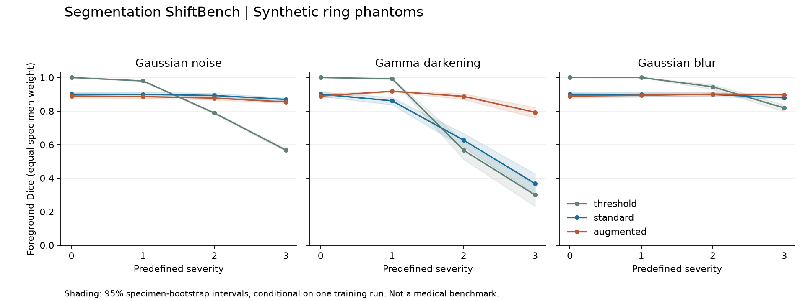
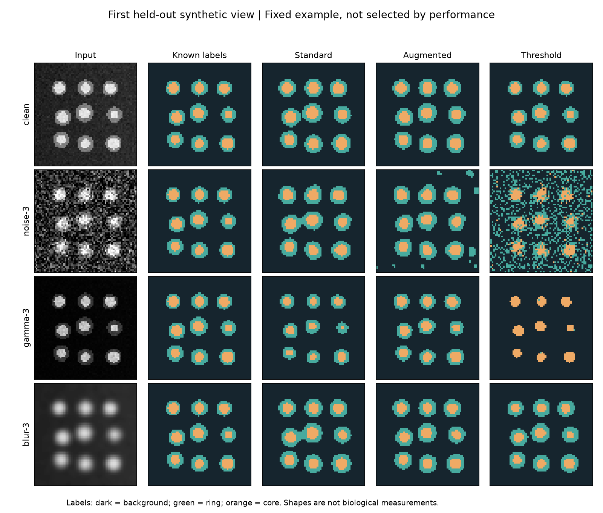

# Segmentation ShiftBench

[](https://github.com/AymenBenalia/segmentation-shiftbench/actions/workflows/tests.yml)

A reproducible CPU experiment for studying how segmentation predictions change under noise, gamma darkening and blur.

Train a compact PyTorch encoder-decoder with and without augmentation, compare both against fixed intensity thresholds, and inspect per-image scores, specimen-level uncertainty and prediction figures. The included dataset is generated geometric ring phantoms, not real microscopy or medical acquisitions.



## What the recorded experiment shows

On the recorded synthetic test set, fixed thresholds achieve a clean-image foreground Dice of **1.000**, while the standard network achieves **0.900** and the augmented network **0.889**. The thresholds use the known phantom intensity levels, so their clean-data advantage is unsurprising.

Under the strongest predefined gamma darkening, the standard network scores **0.368** and the augmented network **0.793**. Under the strongest noise setting, the standard model scores **0.869**, slightly higher than the augmented model's **0.854**. Augmentation is not universally better in this run.

These are measured results from one synthetic-data training seed. They are not percentages of clinical accuracy, evidence of a general improvement, or a comparison against a published scientific model.

[Recorded configuration](results/seed-42/run.json) | [All condition summaries](results/seed-42/summary.csv) | [Per-image measurements](results/seed-42/per_image.csv) | [Experimental protocol](docs/protocol.md)

## Install

Python 3.11 or newer:

```sh
git clone https://github.com/AymenBenalia/segmentation-shiftbench.git
cd segmentation-shiftbench
python -m venv .venv
source .venv/bin/activate
python -m pip install -e '.[test]'
```

The experiment uses PyTorch, NumPy, pandas, scikit-learn and matplotlib. It runs on CPU and does not download a dataset or pretrained weights. On Linux, optionally install the [CPU-only PyTorch wheel](https://pytorch.org/get-started/locally/) before the editable install to avoid installing accelerator packages.

For the top-level library versions used in the recorded run:

```sh
python -m pip install -r requirements-reproduce.txt
python -m pip install --no-deps -e .
```

Transitive dependencies, hardware and OS can still affect reproducibility. See the environment in `run.json` and the [PyTorch reproducibility notes](https://docs.pytorch.org/docs/stable/notes/randomness.html).

## Run

```sh
shiftbench --output runs/my-run --seed 42 --epochs 12
```

The output directory must be empty; previous experiments are never silently replaced. Defaults generate 40 synthetic specimens, three related views per specimen, and 64 x 64 grayscale images. Grouped splits produce 24 training, 8 validation and 8 test specimens.

For a minimal smoke run:

```sh
shiftbench --output runs/smoke --specimens 6 --views 1 --epochs 1
```

The smoke run checks execution, not model quality. The CLI also works as `python -m segmentation_shiftbench`.

## Experimental controls

- **Specimen-level splits:** related views remain in the same partition, using scikit-learn's GroupShuffleSplit. All split assignments are exported.
- **Matched training:** both networks start from the same initialization and use the same batch-order seed, optimizer and epoch budget. The only training difference is a fixed augmentation recipe.
- **Held-out selection:** each network's checkpoint is chosen using the lowest clean validation cross-entropy. The test images and test masks are not used by training or checkpoint selection.
- **Paired evaluation:** all predictors receive the same perturbed test images, generated once per condition.
- **Explicit aggregation:** calculate ring/core Dice per image, average views within each specimen, then weight each specimen equally. Bootstrap specimens, not individual correlated views.
- **Recorded provenance:** dataset fingerprint, seeds, conditions, configuration, environment versions, raw scores and training history are exported.

The augmentation recipe uses gamma in [0.7, 1.5], brightness offsets in [-0.08, 0.08] and Gaussian noise standard deviations in [0, 0.08]. It includes no blur. Evaluation uses three severities each of Gaussian noise, gamma darkening and Gaussian blur, plus clean images. Exact values are saved in `run.json`.

No hyperparameters were adjusted after viewing the recorded test results. The recorded run was repeated to check reproducibility in the same environment.

## Inspect predictions



This is the first held-out view, selected by split order, not the best or worst result. The known geometric labels are background (0), ring (1) and core (2). Foreground Dice is the mean of the ring and core Dice; a class absent from both prediction and target is undefined and omitted. If neither foreground class is present, the score is undefined.

## Outputs

- `standard.pt`, `augmented.pt`: locally generated checkpoint state dictionaries. They are not committed to this repository; reproduce them with the command above.
- `splits.csv`: sample-to-specimen-to-partition mapping.
- `training.csv`: training and clean validation loss per epoch.
- `per_image.csv`: class-level and foreground Dice for every predictor, view and condition.
- `summary.csv`: equal-specimen means and conditional 95% bootstrap intervals.
- `run.json`: configuration, dataset fingerprint, conditions, versions and limitations.
- `robustness.png`, `examples.png`: figures generated from the run.

The repository includes measured results in `results/seed-42/`. Generated training outputs go in the ignored `runs/` directory.

## Evaluate another PyTorch predictor

The evaluation function accepts CPU models that return finite logits with shape `[N, 3, H, W]` for input `[N, 1, H, W]` float tensors in [0, 1]:

```python
import numpy as np
import torch
from segmentation_shiftbench.data import grouped_split, make_phantoms
from segmentation_shiftbench.experiment import evaluate

data = make_phantoms()
test = grouped_split(data.groups)["test"]

# trained_model must predict background=0, ring=1, core=2.
scores = evaluate(
    {"my-model": trained_model},
    torch.from_numpy(data.images[test]),
    data.masks[test], data.groups[test], test, seed=1042,
)
scores.to_csv("my-model-scores.csv", index=False)
```

This interface is a small extension point, not a general medical-image loader. Other data would need compatible tensors, meaningful labels and specimen identifiers; the included ring/core display names are specific to this example.

## Tests

```sh
python -m pytest -q
```

Tests cover grouped split integrity, training independence from test data, repeatable training, perturbation determinism, gradient propagation, absent-class handling, specimen-weighted aggregation, paired inputs, and a complete training/evaluation/export smoke run. GitHub Actions runs the tests on Python 3.11 and 3.12 with CPU-only PyTorch.

## Scope and limitations

This is a software-engineering experiment, not a new segmentation algorithm or an established scientific benchmark. TinyUNet is a small conventional encoder-decoder with one downsampling stage and a skip connection. The synthetic masks are exact by construction, the images are simple, and there is no scanner, pathology, subject diversity or annotation uncertainty.

The bootstrap intervals describe variation between the synthetic test specimens conditional on one fitted model. They do not include training-seed uncertainty and do not establish statistical significance between models. Intensity perturbations preserve the geometric labels by construction; their severities are engineering choices, not calibrated microscope or MRI artifacts.

There is no direct AxonDeepSeg, MONAI or nnU-Net integration, no real-data validation and no affiliation with NeuroPoly. A useful next scientific step would require permission-cleared real data, multiple training seeds, domain-specific shifts, and an independent evaluation protocol.

## Related work

[TorchIO](https://github.com/TorchIO-project/torchio) and [MONAI](https://github.com/Project-MONAI/MONAI) already provide extensive medical-imaging transforms and deep-learning infrastructure. This project does not replace them or claim novelty. Its purpose is a compact, auditable end-to-end experiment that runs without a dataset download or GPU.

The split design follows the rationale for grouped observations in [scikit-learn's cross-validation guide](https://scikit-learn.org/stable/modules/cross_validation.html#cross-validation-iterators-for-grouped-data). Randomness controls follow [PyTorch's reproducibility guidance](https://docs.pytorch.org/docs/stable/notes/randomness.html).

## License

MIT. Generated synthetic figures and measurement outputs are included under the same license.
